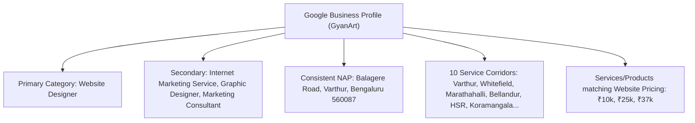
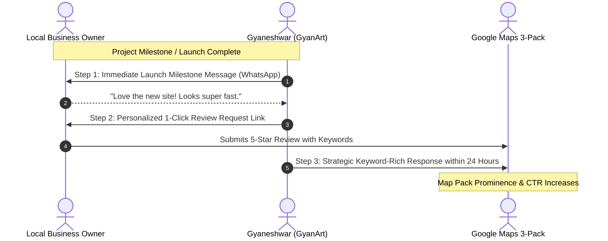
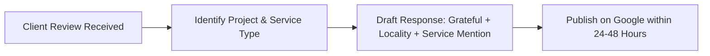
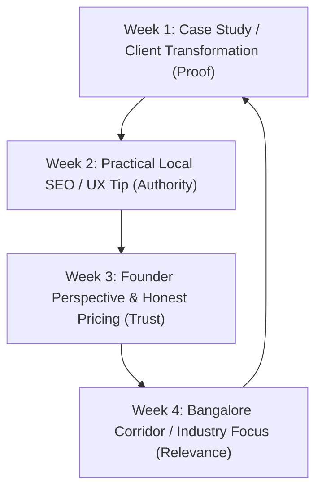
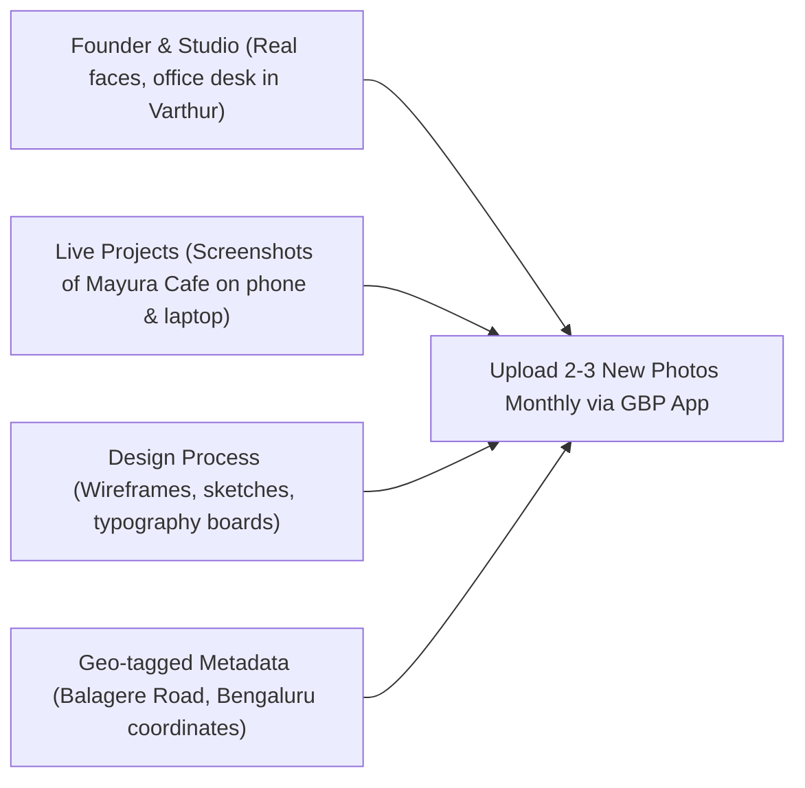
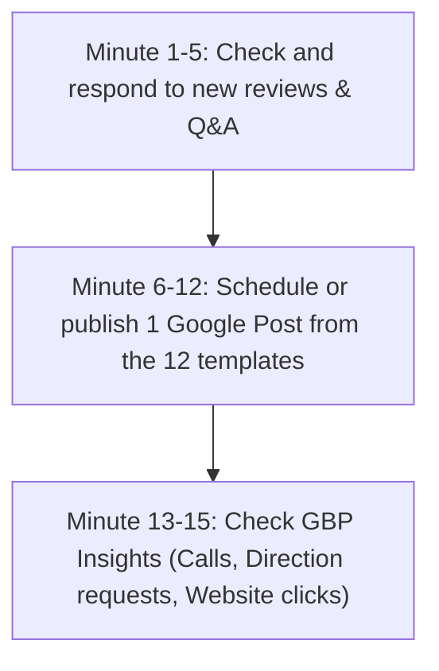

# Google Business Profile (GBP) Strategy & Playbook: GyanArt
**Target Business:** GyanArt (Bangalore UX & Website Design Studio)  
**Primary Map Anchor:** [A107, Hilife Pearl Shell, Balagere Road, Varthur, Bengaluru 560087](https://maps.app.goo.gl/QYAzaKxRDyMyX7RA6)  
**Coordinates:** `12.9395061, 77.7299794` | **Phone:** `+91 98802 08870`  
**Purpose:** Accelerate Google Maps Local 3-Pack prominence for high-intent queries like *"website designer near me"*, *"website design Bangalore"*, and *"local SEO services Whitefield / Varthur"*.

---

## 1. Google Business Profile Optimization & Audit Baseline

To ensure maximum synergy with the website's `ProfessionalService` schema, the GBP dashboard must reflect identical entity data:

### Core Configuration Checklist

| Profile Field | Optimal Setting / Value | Why It Matters |
|---|---|---|
| **Business Name** | **GyanArt** *(or "GyanArt - Website Design & UX")* | Avoid keyword stuffing suspensions; keep aligned with official branding and footer schema. |
| **Primary Category** | **Website Designer** | Heaviest single ranking weight for local web design queries in Bangalore. |
| **Secondary Categories** | 1. Internet Marketing Service 2. Design Agency 3. Marketing Consultant | Captures searches for Local SEO, CRO, and digital growth consulting. |
| **Service Areas** | Varthur, Balagere, Whitefield, Marathahalli, Bellandur, HSR Layout, Koramangala, Indiranagar, BTM Layout, Outer Ring Road. | Aligns with the 10 `areaServed` entries in the website's JSON-LD schema. |
| **Website Link** | `https://www.gyanart.com/?utm_source=gbp&utm_medium=organic&utm_campaign=gmb_listing` | Clean UTM tracking allows Google Search Console & Analytics to isolate Maps traffic from organic clicks. |
| **Appointment Link** | `https://www.gyanart.com/contact.html?utm_source=gbp&utm_medium=appointment` | Direct path for users wishing to book an introductory call. |
| **Attributes** | Identifies as small business, Online appointments, On-site services. | Helps Google match conversational filters. |

---

## 2. Review Acquisition System (The 5-Star Engine)

Google's ranking algorithm weighs **review velocity, star rating, keyword richness in review text, and owner response rate**.

### 2.1 Generating Your Direct 1-Click Review Link
1. Log into [Google Business Profile Manager](https://business.google.com/).
2. Click **"Ask for reviews"** / **"Get more reviews"**.
3. Copy the short link (format: `https://g.page/r/[ID]/review`).
4. Save this URL as a text shortcut on your phone and WhatsApp business quick replies.

---

### 2.2 WhatsApp Review Request Templates

Because business owners in Bangalore communicate primarily on WhatsApp, direct messages achieve a 70%+ conversion rate compared to email.

#### Template A: Post-Launch Milestone (High Enthusiasm)
*Send 2–3 days after a website launch or audit delivery when the client is happy.*

> "Hi [Client Name], really enjoyed collaborating on [Business Name]'s new website and watching it go live! 🚀
> 
> As a boutique studio in Bangalore, genuine feedback from local business owners means the world to me. Could you spare 60 seconds to share your experience on my Google profile?
> 
> Here is a direct link:  
> [INSERT_DIRECT_GBP_REVIEW_LINK]
> 
> If you could mention the specific area we worked on—like the **mobile design**, **website speed**, or **customer enquiry flow**—it helps other local businesses find me. Thank you so much!  
> — Gyaneshwar"

#### Template B: Post-Free Growth Audit (Value-First Request)
*Send after delivering a free Growth Audit with actionable insights.*

> "Hi [Client Name], glad the Growth Audit for [Business Name] gave you clear clarity on your Google Maps and website structure!
> 
> If you found the analysis helpful, I would be grateful if you could drop a short review on Google Maps about the audit experience:  
> [INSERT_DIRECT_GBP_REVIEW_LINK]
> 
> Wishing you great growth this month!  
> — Gyaneshwar"

#### Template C: Kannada Language Template (Regional Founders)
*For local business owners in Bangalore who prefer Kannada.*

> "ನಮಸ್ಕಾರ [Client Name], ನಿಮ್ಮ [Business Name] ವೆಬ್‌ಸೈಟ್ ಪ್ರಾಜೆಕ್ಟ್‌ನಲ್ಲಿ ನಿಮ್ಮೊಂದಿಗೆ ಕೆಲಸ ಮಾಡಿದ್ದು ತುಂಬಾ ಸಂತೋಷವಾಯಿತು. 
> 
> ಬೆಂಗಳೂರಿನಲ್ಲಿ ನಮ್ಮ ಸ್ಥಳೀಯ ವ್ಯವಹಾರಕ್ಕೆ ನಿಮ್ಮ ಅಮೂಲ್ಯವಾದ ಅನಿಸಿಕೆ (Google Review) ತುಂಬ ಮುಖ್ಯವಾಗಿದೆ. ದಯವಿಟ್ಟು 1 ನಿಮಿಷ ಸಮಯ ತೆಗೆದುಕೊಂಡು ನಿಮ್ಮ ಅನುಭವವನ್ನು ಇಲ್ಲಿ ಹಂಚಿಕೊಳ್ಳಿ:  
> [INSERT_DIRECT_GBP_REVIEW_LINK]
> 
> ನಿಮ್ಮ ಸಹಕಾರಕ್ಕೆ ಧನ್ಯವಾದಗಳು!  
> — ಜ್ಞಾನೇಶ್ವರ್ (GyanArt)"

---

### 2.3 Review Response Framework

Always respond within 24–48 hours. **Never post generic "Thanks!" replies.** Use responses to reinforce your geographic location and core capabilities for Google's NLP algorithm:

#### Example Review 1: Restaurant / Food Business
- **Client says:** *"Gyaneshwar built a fantastic website for our restaurant. The digital menu is fast and customers love it."*
- **Optimal Response:**  
  *"Thank you so much, [Client Name]! It was a pleasure designing the visit-first mobile menu and Google Maps navigation for [Restaurant Name] here in Bangalore. Making sure diners can find your location easily without dealing with heavy PDF downloads was our top priority. Wishing your team continued success!"*

#### Example Review 2: Professional Service / Consultant
- **Client says:** *"Very professional UX insights and clear pricing. Helped us redesign our consulting website."*
- **Optimal Response:**  
  *"Thank you for the kind words, [Client Name]! Working on the website redesign and customer journey for your practice in [Area, e.g., Whitefield / HSR] was a great project. We focused on clear credibility and straightforward enquiry paths. Appreciate your partnership!"*

---

## 3. Weekly Google Post Publishing System (4-Week Cadence)

Google Posts expire in visibility after a few weeks, but actively signal to Google's ranking crawler that the business is open, active, and relevant.

### 12 Ready-to-Publish Post Templates

#### Week 1: Case Study & Proof
- **Post 1: Restaurant Mobile UX (Mayura Cafe Highlight)**
  > **Headline:** Why your restaurant website shouldn't force customers to download a 15MB PDF menu.  
  > **Body:** When diners search for your restaurant in Bangalore, they are on mobile data and want three things fast: what you serve, what it costs, and how to reach you via Google Maps. For Mayura Cafe & Food Court, we built a zero-lag, responsive digital menu and 1-tap Google Maps directions. No clunky PDFs. Just clear answers.  
  > **CTA Button:** Learn More → `https://www.gyanart.com/case-studies/mayura-cafe.html`  
  > **Photo:** Screenshot of Mayura Cafe mobile view on phone mockup.

- **Post 2: Fixing the "Visitors Don't Contact You" Problem**
  > **Headline:** Getting website traffic in Bangalore but zero phone calls or WhatsApp messages?  
  > **Body:** More ad spend won't fix a confusing website journey. If your phone number is buried, pricing is hidden, or the mobile experience is frustrating, potential customers bounce back to Google. We design clear, conversion-focused websites that make reaching out effortless.  
  > **CTA Button:** Call Now → `tel:+919880208870`  
  > **Photo:** High-contrast graphic showing enquiry journey flow.

- **Post 3: The Multi-Location Business Dilemma**
  > **Headline:** Running a business with multiple branches across Bangalore?  
  > **Body:** Avoid splitting your domain authority. A well-architected website connects each branch to its dedicated Google Business Profile location pin while sharing core service credibility. Here is how clean UX and structured data keep your brand cohesive.  
  > **CTA Button:** Learn More → `https://www.gyanart.com/solutions.html`

---

#### Week 2: Practical Local SEO & UX Tips
- **Post 4: Google Business Profile Categories Guide**
  > **Headline:** The #1 reason Bangalore businesses fail to show up in the Google Maps 3-Pack.  
  > **Body:** Your Primary GBP Category carries up to 60% of your local ranking weight. If a clinic sets their category as "Corporate Office" instead of "Dental Clinic", Google simply won't show them to nearby patients. Keep your primary and secondary categories laser-focused on what customers actually search for.  
  > **CTA Button:** Book → `https://www.gyanart.com/insights/google-business-profile-local-seo-guide.html`

- **Post 5: Speed Is a Feature (0 Hydration Lag)**
  > **Headline:** Why a 4-second website loading delay costs you half your customers.  
  > **Body:** Over 78% of local service searches in Bangalore happen on mobile devices while traveling. Heavy WordPress themes with 35 plugins drain battery and frustrate visitors. GyanArt builds lean, high-speed static websites that load in under 1 second.  
  > **CTA Button:** Learn More → `https://www.gyanart.com/website-design.html`

- **Post 6: AI Search & ChatGPT for Local Businesses**
  > **Headline:** What happens when Bangalore customers ask ChatGPT or Perplexity for recommendations?  
  > **Body:** AI search engines don't browse websites like humans. They look for clear answer blocks, structured data, and authentic local citations. Is your website structured to be cited by AI? Read our latest guide on AI search visibility.  
  > **CTA Button:** Learn More → `https://www.gyanart.com/insights/ai-search-google-visibility-local-business.html`

---

#### Week 3: Founder Perspective & Honest Pricing
- **Post 7: The ₹5,000 Website Trap**
  > **Headline:** Why do some agencies quote ₹5,000 while others quote ₹1,00,000 for a website in Bangalore?  
  > **Body:** A ₹5,000 website is almost always an automated, cookie-cutter template with placeholder text and zero search structure. GyanArt provides founder-led UX leadership at transparent rates (₹10,000 to ₹37,000), working directly with a designer with 20+ years of digital experience.  
  > **CTA Button:** View Pricing → `https://www.gyanart.com/insights/website-design-cost-in-bangalore.html`

- **Post 8: Working Directly with a Senior Designer vs Account Managers**
  > **Headline:** Tired of speaking to junior account managers who don't understand your business?  
  > **Body:** At GyanArt, you collaborate directly with Gyaneshwar. No sales reps, no layers of bureaucracy, and no inflated agency retainers. Just senior design thinking applied directly to your business goals.  
  > **CTA Button:** Call Now → `tel:+919880208870`

- **Post 9: What Is Included in Ongoing Website Maintenance?**
  > **Headline:** What does website maintenance actually mean for a small business?  
  > **Body:** You don't need a ₹15,000/month agency retainer just to update your phone number or add festive hours. GyanArt offers transparent ₹1,000–₹3,000 monthly support covering security, text updates, and local SEO maintenance.  
  > **CTA Button:** View Details → `https://www.gyanart.com/pricing.html`

---

#### Week 4: Local Corridor & Industry Focus
- **Post 10: Varthur & Balagere Local Tech Corridor**
  > **Headline:** Proud to support local businesses across Varthur, Balagere, and Whitefield.  
  > **Body:** As East Bangalore grows rapidly with residential communities and tech hubs, local businesses need a digital presence that helps nearby residents find and choose them over distant competitors. Let's make your local presence shine.  
  > **CTA Button:** Book → `https://www.gyanart.com/growth-audit.html`

- **Post 11: Websites for Professional Services (CA, Legal & Architecture)**
  > **Headline:** High-value clients research your firm before booking a consultation.  
  > **Body:** For Bangalore consultants, law practices, and architecture studios, a website must establish authority immediately. We design calm, credible, conversion-focused websites that turn casual inquiries into high-value client consultations.  
  > **CTA Button:** Learn More → `https://www.gyanart.com/professional-services.html`

- **Post 12: Direct WhatsApp Booking Integration**
  > **Headline:** Make it 1 tap for Bangalore customers to WhatsApp your business.  
  > **Body:** In India, forcing a customer to fill out an 8-field contact form results in high abandonment. Pre-filled WhatsApp buttons allow potential clients to initiate conversations with zero friction. We build this natively into every website.  
  > **CTA Button:** Call Now → `tel:+919880208870`

---

## 4. Google Maps Q&A Pre-Population (Seeded FAQ Strategy)

Anyone can ask and answer questions on your Google Maps listing. **You should proactively ask and answer your own top customer questions** from your verified owner profile:

| Seeded Question to Ask | Verified Owner Answer (Post as GyanArt) |
|---|---|
| **"How much does a website design cost for a small business in Bangalore?"** | *"GyanArt website packages start at ₹10,000 for standard local business sites, ₹25,000 for customized conversion-focused structures, and ₹37,000 for larger platforms. All pricing is transparent with no hidden agency fees."* |
| **"Which areas in Bangalore do you provide website design services?"** | *"Our studio is located on Balagere Road in Varthur, and we work directly with business owners across Bangalore, including Whitefield, Marathahalli, Bellandur, HSR Layout, Koramangala, and Indiranagar."* |
| **"Do you help with Google Maps and local SEO optimization?"** | *"Yes. Every website package includes Google Business Profile coordination: ensuring categories, verified address coordinates, opening hours, and local service areas match your website structure."* |
| **"How long does it take to design and launch a business website?"** | *"A standard 5-to-10 page small business website typically launches within 2 to 3 weeks once text and images are confirmed."* |

---

## 5. Photo & Media Optimization Guidelines

Google rewards listings with frequent, high-quality, authentic photography:

1. **File Naming Convention:** Rename images before uploading to reinforce keywords:
   - `gyanart-website-design-studio-varthur-bangalore.jpg`
   - `mayura-cafe-restaurant-website-preview.jpg`
   - `gyaneshwar-ux-designer-bangalore.jpg`
2. **Photo Types to Include:**
   - **Identity:** High-resolution GyanArt SVG/PNG logo and official profile cover.
   - **Founder Portrait:** Professional, approachable photo of Gyaneshwar.
   - **Workspace / Studio:** Clean photo of the workspace in Hilife Pearl Shell, Varthur.
   - **Work in Progress:** Real photos of wireframes, tablet mockups, and live site previews.

---

## 6. The 15-Minute Weekly GBP Routine

A recurring calendar event (e.g., every Monday at 10:00 AM):

- **Minute 1–5:** Check for new reviews. Post a keyword-rich, personalized response within 24 hours.
- **Minute 6–12:** Copy 1 pre-written post from the 12 templates above, attach an authentic screenshot or graphic, and publish with the appropriate CTA link.
- **Minute 13–15:** Review weekly discovery analytics in Google Business Profile (calls initiated, website clicks, search queries that triggered your listing).

---
*Playbook created for GyanArt Digital Growth Consultancy.*
